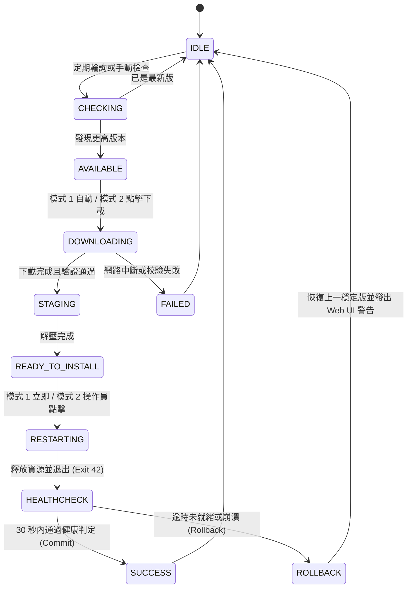

# ADR-019：邊緣端自動更新機制與安全升級架構 (Edge Auto-Update & Safe Upgrade Architecture)

| 欄位 | 內容 |
|------|------|
| **狀態** | 已接受 (Accepted) |
| **日期** | 2026-09-21 |
| **決策者** | 開發團隊 |
| **相關 ADR** | [ADR-004](ADR-004-global-vars-cross-thread.md)、[ADR-005](ADR-005-arm64-build-constraint.md)、[ADR-009](ADR-009-sse-over-websocket-detection-channel.md)、[ADR-013](ADR-013-ums-client-model-sync.md)、[ADR-018](ADR-018-modular-domain-directory-layout.md) |
| **相關 Spec / 票券** | Gitea [#75](http://tncimweb.cminl.oa/git-server/guy.mai/safety-predictor-nano/issues/75) ~ [#81](http://tncimweb.cminl.oa/git-server/guy.mai/safety-predictor-nano/issues/81), [.scratch/auto-update-mechanism/map.md](../../.scratch/auto-update-mechanism/map.md) |

---

## 情境與問題 (Context & Problem)

Argus Safety Predictor Nano 是部署於工廠邊緣裝置（如 Raspberry Pi 5 ARM64）的無周邊 (headless) 即時工安目標偵測推論系統。在生產環境運作時，面臨以下升級與維護挑戰：

1. **手動部署的高人力維運成本**：過去版本更新仰賴工程師透過 SSH 手動連線至廠區裝置，傳輸新版 PyInstaller 打包目錄並手動重啟，當設備節點擴充至數十台時維運成本急遽上升。
2. **中心化版本管理與分發整合需求**：廠區內部已有 App Management API（CIM API Gateway），負責集中託管應用程式版本中繼資料 (`/App/{appId}/Version`)、發布包下載資訊 (`/File/{appId}/DownloadInfo`) 與二進位分塊下載 (`/File/{appId}`)。邊緣端需要標準化整合此服務以達到自動化輪詢與安全下載。
3. **PyInstaller `--onedir` 運行時動態庫替換安全 (Linux Shared Library Locking)**：
   - 根據部署規範（方案 C），系統以 `--onedir` 模式打包為 `argus_predictor/` 資料夾（內含執行檔與 `_internal/` 動態共享庫）。
   - 在 Linux 系統中，若直接在運行目錄原地覆寫動態庫（如 `libopencv_*.so` 或 `libtorch.so`），執行中的行程會遭遇記憶體頁面損毀或 `SIGSEGV` 致命崩潰。
4. **非破壞性零資料遺失 (Zero Data Loss) 要求**：
   - 升級程序嚴禁破壞或覆蓋裝置本機已配置的客製化檔案，包括 `config.yaml`、已下載的模型權重檔 (`models/*.pt`) 與歷史稽核日誌 (`logs/`)。
5. **手動執行（非 systemd）環境下的自我重啟與容錯回滾**：
   - 裝置多由操作員或啟動腳本於終端手動啟動，缺少中央行程監控器。新版本若因動態庫缺失、模型檔損毀或語法異常引發開機失敗，必須具備本機自動復原（Auto-Rollback）能力，在 30 秒內自動回滾至上一穩定版本，避免產線偵測中斷成為「死機」。

---

## 決策選項與架構設計 (Decisions & Architecture)

### 1. App Management API 客戶端整合與容錯策略

- **API 介接規範**：
  - 端點 1：`GET /App/{appId}/Version/nocache`，過濾出 `released == true`、`autoUpdate == true`、`locked == false` 且符合廠區之候選清單。
  - 端點 2：`GET /File/{appId}/DownloadInfo?version={version}`，取得目標版本的檔案中繼資料（`owner`、`filesInfo`）。
  - 端點 3：`GET /File/{appId}?owner={owner}&version={version}&filePath={filePath}`，進行二進位分塊下載。
- **SemVer 2.0.0 版本比對**：
  - 統一正規化去除版本前綴 `v`/`V`，以 `major.minor.patch` 進行嚴格數學比對。
  - 支援更新通道過濾：預設 `channel: "stable"`，自動過濾含有 prerelease（如 `-rc`, `-alpha`）之非穩定版本。
- **網路容錯與串流下載**：
  - 整合現有 `ums-api-config.json`，支援主/備 API Gateway 端點自動 Failover。
  - 採 1MB 分塊串流（Chunked Stream）寫入暫存檔，搭配 200ms 節流之進度回呼（Progress Callback），向 Web UI 廣播傳輸位元組、速度與百分比。
  - 實施磁碟剩餘空間防護檢查：下載前驗證目標分割區至少具備發布包大小之 2.5 倍空間（預留解壓縮與備份緩衝）。

### 2. `--onedir` 發布包結構與防毀損設計

發布壓縮包統一命名為 `argus_predictor-v{VERSION}-arm64.tar.gz`，內層結構如下：

```text
argus_predictor-v{VERSION}-arm64.tar.gz
├── install.sh                  # 安裝/升級核心腳本
├── run.sh                      # 工作目錄鎖定與守護啟動腳本
├── version.txt                 # 版本號識別
├── checksums.sha256            # 雜湊校驗檔
└── payload/                    # 核心二進位載荷
    ├── argus_predictor         # 主執行檔 (PyInstaller ELF)
    ├── _internal/              # 動態連結庫與 Python 運行環境
    ├── config.default.yaml     # 預設出廠設定範本 (不覆蓋 config.yaml)
    ├── ums-api-config.json     # 預設 API 路由設定
    └── models/                 # 隨附基礎模型權重 (可選)
```

- **零資料遺失保障**：
  - 升級時既有 `config.yaml` 永不被覆蓋，新版設定欄位以 `config.default.yaml` 釋出供使用者手動合併。
  - 模型目錄 (`models/`) 於備份時採用硬連結 (`cp -al`)，秒級完成且不額外消耗實體磁碟容量。
  - 日誌目錄 (`logs/`) 原地保留，不隨程式二進位目錄遷移。

### 3. Staging 目錄暫存與原子目錄替換 (Atomic Swap)

- **避免原地解壓**：下載之壓縮包解壓至獨立之暫存目錄 `updates/staging/`，並驗證二進位檔存在且具備執行權限。
- **兩階段目錄原子替換**：
  1. 將現行正式目錄 `argus_predictor/` 重新命名為 `argus_predictor_bak/`（保留前一穩定版本）。
  2. 將 `updates/staging/` 重新命名為正式目錄 `argus_predictor/`。
  3. 由於 Linux `rename()` 系統呼叫為目錄層級之原子操作 (Atomic Operation)，耗時在毫秒以內，徹底解決動態庫寫入導致的崩潰風險。

### 4. 雙重自我重啟機制 (Dual Self-Restart Mechanism)

為同時相容「透過腳本啟動」與「直接執行二進位檔」之兩種邊緣操作情境，系統採用雙重重啟設計：

1. **主機制（推薦路徑）：`run.sh` 守護迴圈監聽 Exit Code 42**：
   - 啟動腳本 `run.sh` 內建 `while true` 外層守護迴圈。
   - 當主程式準備重啟時，釋放推論與串流資源後主動呼叫 `sys.exit(42)` (RESTART_FOR_UPDATE)。
   - `run.sh` 捕捉到 Exit 42 後，自動休眠 1 秒並以 `exec` 重新執行更新後之最新版二進位檔。
2. **容錯機制：Detached `updater_helper.sh` 背景守護進程**：
   - 若使用者未透過 `run.sh` 直接以 `./argus_predictor` 啟動，更新管理員以 `subprocess.Popen(..., start_new_session=True)` 脫離終端啟動獨立 Helper 腳本。
   - 主程式呼叫 `sys.exit(0)` 優雅退出，Helper 監控舊 PID 徹底終止後，執行目錄替換並啟動新版程式。

### 5. 雙更新模式與狀態機規範 (Dual Update Modes & State Machine)

系統於 `config.yaml` 支援兩種更新運作模式：
- **模式 1 (Unattended / 無人值守)**：背景下載驗證完成後，自動執行原子替換並倒數 3 秒自我重啟。適用於無人巡檢之封閉閘門節點。
- **模式 2 (Notify / 提示手動確認，預設)**：背景下載並完成 Staging 驗證後，進入 `READY_TO_INSTALL` 狀態。Web UI 頂端閃爍呼吸徽章通知，由操作員於安全空檔（如停線維修期）點擊確認後才執行重啟。

**狀態機生命週期圖**：



### 6. 30 秒健康狀態判定與自動回滾容錯策略 (Healthcheck & Auto-Rollback)

- **三階段健康指標判定 (Three-Stage Health Criteria)**：
  1. **階段 1：進程存活 (Process Liveness)**：守護腳本每秒以 `kill -0 $PID` 檢查進程，若進程在 30 秒內異常終止且退出碼非 42，立即判定崩潰。
  2. **階段 2：HTTP 探針就緒 (HTTP Readiness)**：每隔 1.5 秒向本機 `http://127.0.0.1:8188/api/health` 探測，必須取得 HTTP 200 及 `status: "healthy"`。
  3. **階段 3：推論管線就緒 (Inference Verification)**：核心推論迴圈成功載入 YOLO 模型，並完成至少一幀推論（標記 `first_frame_inferred: true`）。
- **健康確立 (Commit)**：30 秒窗口內全數滿足指標，守護程序移除 `.update_in_progress` 標記檔，並於 `logs/update.log` 記錄 `[COMMITTED]`。
- **自動回滾五步驟**：
  1. 強制終止任何異常殘留進程 (`SIGTERM` -> 3s -> `SIGKILL`)。
  2. 隔離失敗現場：將損毀之 `argus_predictor/` 重新命名為 `argus_predictor_failed_<timestamp>/` 以供後續除錯（磁碟僅保留最新 1 份）。
  3. 原子還原備份：將 `argus_predictor_bak/` 重新命名回 `argus_predictor/`。
  4. 喚醒穩定版本：重新啟動還原後之上一版本。
  5. 記錄並警示：寫入 `logs/update_rollback.log` 並建立 `.rollback_alert`，由 Web UI 彈出紅色橫幅警示操作員。
- **死迴圈防護 (Rollback Loop Guard)**：若舊版本啟動依然崩潰，看門狗偵測到已執行過回滾，立即進入 `FATAL_HALT` 狀態，防止無窮迴圈重啟打滿磁碟。

### 7. Web UI 互動設計與 SSE 即時進度通道

- **導覽列版本互動標籤**：`.version-tag` Cyberpunk 青藍發光外框，點擊直接開啟更新對話框。
- **動態更新提示徽章**：偵測到新版時浮現呼吸發光按鈕（`AVAILABLE` 顯示青綠 `[ 🚀 新版本可用 ]`；`READY_TO_INSTALL` 顯示橘黃 `[ ⚠️ 更新就緒，點擊重啟套用 ]`）。
- **更新管理彈窗**：
  - 4 格關鍵指標卡（目前版本、最新版本、發布時間、更新模式）。
  - Release Notes 終端展示框。
  - 實時下載/解壓進度條（顯示百分比、已下載量/總量、即時傳輸速率）。
- **SSE 通道 (`/api/update/stream`)**：透過單一輕量 SSE 通道廣播更新狀態與進度 JSON，前端免除高頻輪詢開銷。
- **重啟全螢幕遮罩與自動重連**：重啟時鎖定全螢幕並呈現 30 秒倒數，前端以 1.5 秒間隔自動向 `/api/health` 輪詢，服務重啟就緒後自動重載頁面 (`window.location.reload()`)。

---

## 衍生後續與影響 (Consequences)

### 正面影響 (Positive)
1. **維運零負擔**：支援無人值守與工廠排程手動套用，大幅降低現場工程師出勤維護時間。
2. **高可靠性與產線零死機**：透過 Staging 原子替換、30 秒看門狗評估窗口與硬連結備份自動回滾，確保在更新包損毀、動態庫遺失或網路中斷時，裝置能在 30 秒內自動恢復運作。
3. **無損無破壞升級**：嚴格保留既有配置檔、模型檔案與稽核日誌，確保邊緣累積的組態與偵測數據不遺失。
4. **極致操作體驗**：Web UI Cyberpunk 風格無縫整合，SSE 實時進度呈現與重啟自動重連，提供直覺透明的升級體驗。

### 負面影響與限制 (Negative & Trade-offs)
1. **磁碟空間需求**：更新期間裝置需預留發布包大小約 2.5 倍之暫存與隔離空間（約 800MB ~ 1.2GB）。
2. **重啟推論微中斷**：雖然目錄替換為毫秒級原子操作，但行程重啟與模型重新加載約需 5 ~ 15 秒（視 YOLO 模型大小而定），此期間即時推論暫停。

---

## 相關文件與參考
- [App Management API 規格手冊 (v9.2.0)](http://tncimweb.cminl.oa/appmanagementapi)
- [實作計畫與規格書 (`.scratch/auto-update-mechanism/spec.md`)](../../.scratch/auto-update-mechanism/spec.md)
- [Web UI 獨立互動原型 (`.scratch/auto-update-mechanism/prototypes/update_modal_prototype.html`)](../../.scratch/auto-update-mechanism/prototypes/update_modal_prototype.html)
